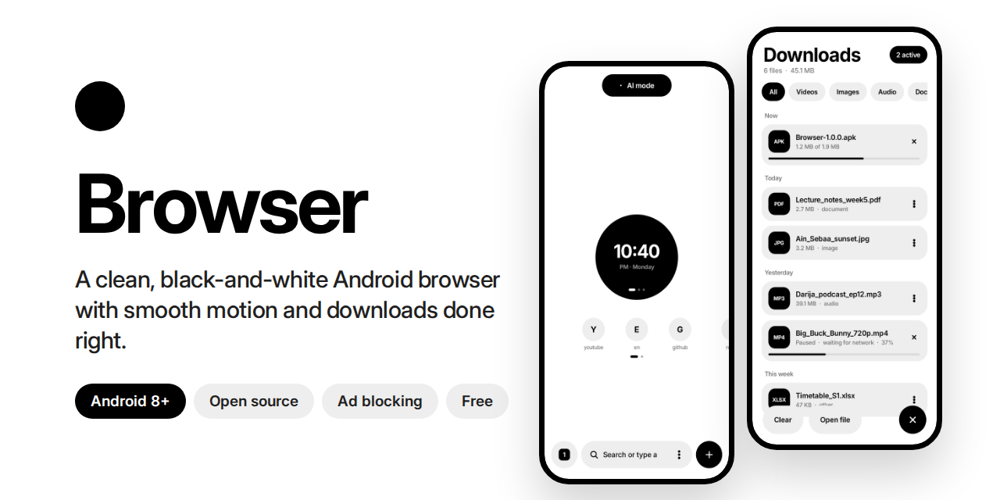
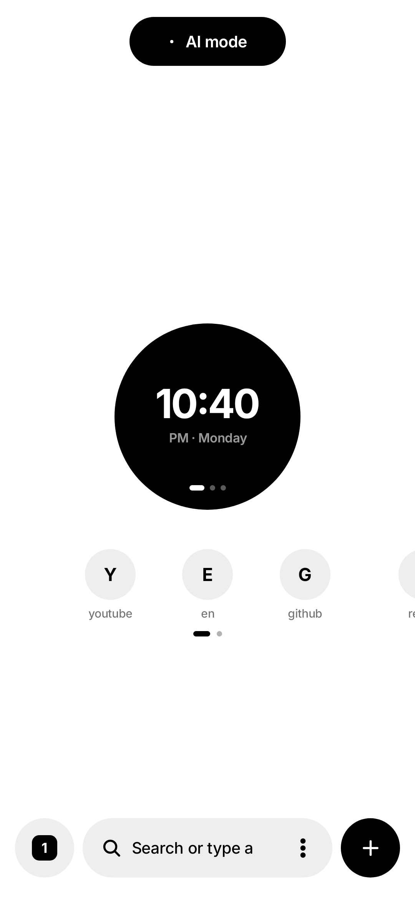
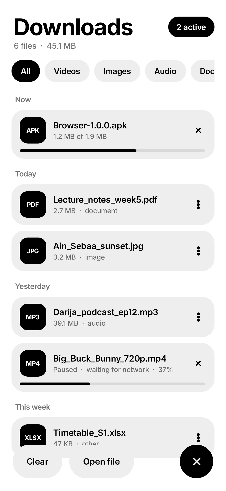
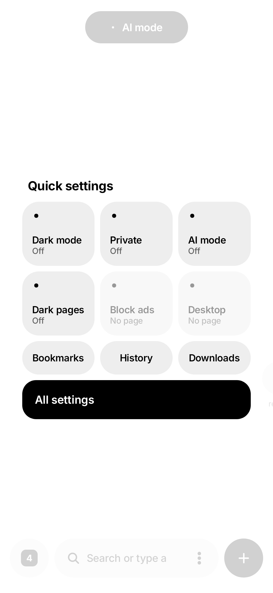
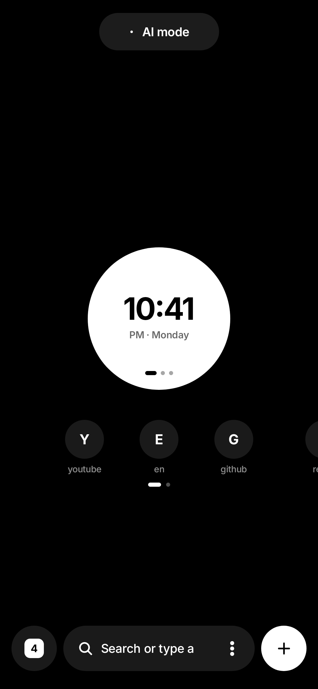
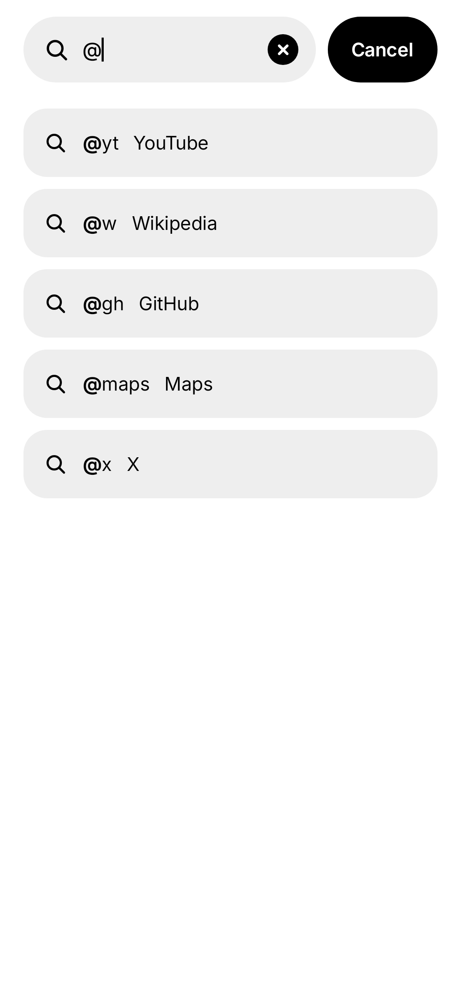
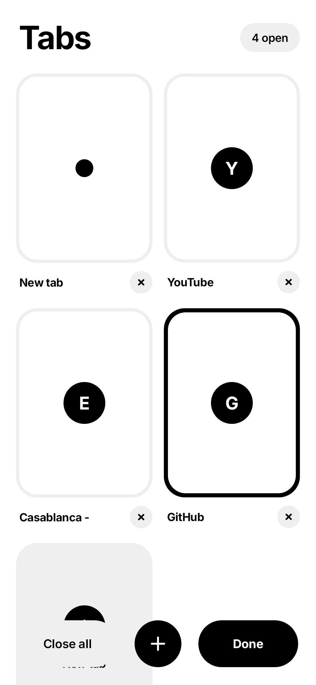
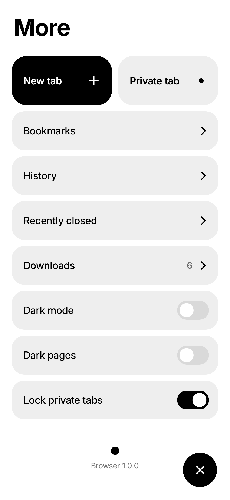
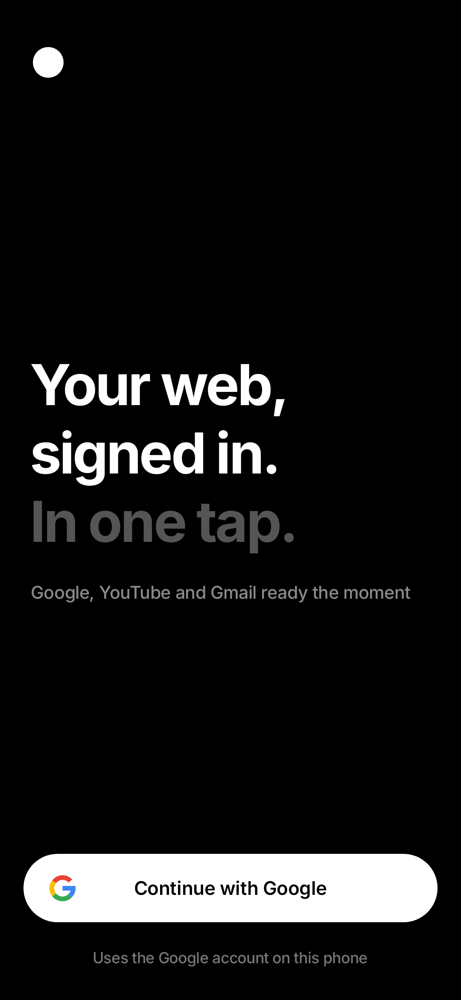

<p align="center">
  
</p>

<p align="center">
  
</p>

<h1 align="center">Browser</h1>

<p align="center"><b>A clean, black-and-white Android browser with smooth motion and downloads done right.</b></p>

<p align="center">
  <a href="https://github.com/Walidkhalid12/Browser/releases/download/v1.0.0/Browser-1.0.0.apk">
    
  </a>
</p>

<p align="center">
  <a href="https://github.com/Walidkhalid12/Browser/releases/latest"></a>
  
  
  <a href="LICENSE"></a>
</p>

---

Most browsers feel crowded, and their downloads are an afterthought. **Browser** keeps only what you need on screen, moves smoothly, and treats downloads like a real feature: you see the speed, the time left, a preview of every file, and you can open it right inside the app.

It's free, open source, and only about 2 MB.

## Screenshots

<table>
  <tr>
    <td align="center"><br><sub>Home</sub></td>
    <td align="center"><br><sub>Downloads</sub></td>
    <td align="center"><br><sub>Quick settings</sub></td>
    <td align="center"><br><sub>Dark mode</sub></td>
  </tr>
  <tr>
    <td align="center"><br><sub>Search shortcuts</sub></td>
    <td align="center"><br><sub>Tabs</sub></td>
    <td align="center"><br><sub>Settings</sub></td>
    <td align="center"><br><sub>First launch</sub></td>
  </tr>
</table>

<sub>These screens are drawn from the app's own code at 1080 × 2340. The history, tabs and downloads in them are sample data.</sub>

## Features

**A calm design**
- Pure black and white with the Inter font, in light and dark mode. Dark mode follows your phone the first time.
- **Dark pages** darkens websites too.
- One bar at the bottom: tabs, search, and a new-tab button. It slides away while you read and comes back when you scroll up. Swipe on it to switch tabs.

**A home screen that's useful**
- The dot in the middle shows small widgets you can swipe through: time, date, weather, battery, open tabs, downloads and ads blocked. Hold the dot to choose them.
- Your most visited sites sit right under the dot.

**Downloads done right**
- Live speed and time left, plus the number of files and their total size.
- Filters for videos, images, audio and documents, grouped by day, with thumbnails for photos and videos.
- A menu on every file: open, open with, share, copy link, retry, remove or delete.
- Clear reasons when a download is paused or fails, better file names, and no duplicate downloads of the same link.
- A built-in viewer for images (pinch to zoom), video, audio, PDF and text files. APK files install in one tap.

**Fast search**
- Autocomplete from the sites you visit, and paste and go.
- Shortcuts: type `@yt`, `@w`, `@gh`, `@maps` or `@x` to search YouTube, Wikipedia, GitHub, Maps or X.
- Voice search with its own animated screen.
- **AI mode:** turn it on and questions are answered by Google AI Mode in a clean screen, with images, sources and follow-up questions.

**Privacy**
- Blocks ads and trackers, and hides cookie banners.
- Private tabs that lock with your fingerprint or PIN, and delete what those sites stored when you close them.
- Camera, microphone and location are asked for per site, and you can remove them later.
- Websites with bad security certificates are refused.

**Tabs and tools**
- Undo close, recently closed tabs, and tabs that come back after the app is closed.
- Open links in the background or in a private tab.
- Reader mode, translate, site info, QR code for any page, add to home screen, save as PDF, desktop mode and text size per site.
- Background audio and video, picture-in-picture, and full-screen video that turns to landscape.
- Home-screen widgets: search bar, quick actions, top sites, ads blocked, and the dot.

## Why it's different

- **Less on screen.** No clutter, no outlined buttons, just solid shapes in black and white.
- **Downloads are a real feature,** not a hidden list.
- **Tuned for everyday phones.** Version 1.0.0 is a performance release built and tuned for the Redmi Note 9. It runs at your screen's highest refresh rate and ships with a baseline profile so it starts fast.
- **Small and open.** About 2 MB, MIT licensed, and every line of code is here.

## Requirements

- Android 8.0 (API 26) or newer
- A Google account on the phone for the first-launch sign-in (it signs Google, YouTube and Gmail in on the web for you)

## Install

1. On your phone, open the [latest release](https://github.com/Walidkhalid12/Browser/releases/latest) and download **Browser-1.0.0.apk**.
2. Open the file. If Android asks, allow your browser or file manager to **install unknown apps**.
3. Tap **Install**.
4. **Play Protect** may warn you because the app isn't from the Play Store. Tap **More details**, then **Install anyway**.

You can check the file with its SHA-256, listed on the release page.

## Build from source

You need **JDK 17 or newer** and the **Android SDK** (platform 36, build tools 35.0.0). Android Studio includes both.

```bash
git clone https://github.com/Walidkhalid12/Browser.git
cd Browser
./gradlew assembleDebug
```

The APK lands in `app/build/outputs/apk/debug/`.

For a release build, run `./gradlew assembleRelease`. To sign it with your own key, add a `keystore.properties` file in the project folder (it's ignored by git):

```properties
storeFile=path/to/your.jks
storePassword=...
keyAlias=...
keyPassword=...
```

Without that file, release builds are signed with the debug key.

Run the tests with `./gradlew testDebugUnitTest`.

## Tech stack

- **Kotlin** and **Jetpack Compose** (foundation only, no Material), with custom animations
- **Android WebView** with AndroidX WebKit for pages
- Android **DownloadManager** for downloads
- **Robolectric** for UI tests
- R8 shrinking and a baseline profile for release builds

## Privacy notes

- The weather widget finds your rough location from your internet address (ipwho.is or ipapi.co) and gets the weather from Open-Meteo, or wttr.in as a backup.
- AI mode loads Google AI Mode in the background to get the answer.
- Ad blocking uses a built-in list in `app/src/main/assets/blocklist.txt`.

## Not in 1.0 yet

- Tab groups with drag to reorder
- Link preview on long-press
- Actions for selected text
- Scanning QR codes with the camera
- A separate cookie jar for private tabs
- Downloads from `blob:` and `data:` links

## Contributing

Ideas and fixes are welcome.

1. Open an [issue](https://github.com/Walidkhalid12/Browser/issues) to report a bug or suggest something.
2. For code, fork the repo, make your change on a new branch, and open a pull request.
3. Please keep the look the same: black and white, solid shapes, smooth motion.

## License

Released under the [MIT License](LICENSE). © 2026 Walidkhalid12
